# Quiet Mouse

[](LICENSE)
[](https://github.com/yezicheng2011/QuietMouse/releases)

<p align="center">
  
</p>

在 Mac 上给苹果妙控鼠标加上「轻点即可点击」：不用把鼠标按下去，点击更安静；滚动和手势保持不变。

Quiet Mouse adds tap-to-click to the Apple Magic Mouse on macOS. A light tap is enough — you don't have to press the mouse down — so clicks stay quiet. Scrolling and gestures are unchanged.

## 功能

- 在鼠标表面**左半边轻点**等于左键，**右半边轻点**等于右键。分界跟随「系统设置 → 鼠标」里的左右键划分；若系统设为单键，每次轻点都是左键。
- **不用按下去**，所以几乎没有按键声。
- **滚动、滑动手势不受影响**。两根手指会取消这次轻点，避免误点。
- 原来的实体按压仍然有效。轻点如果正好赶上实体按压，会被忽略，避免连点两次。
- 菜单栏小图标：可开关轻点点击、设置登录时打开，以及跳到权限设置。
- 需要 **macOS 13** 或更高版本，以及带多点触控表面的妙控鼠标（Magic Mouse）。

## 安装

到 [Releases](https://github.com/yezicheng2011/QuietMouse/releases) 下载 `QuietMouse-<版本>-macos.zip`，解压后把 `QuietMouse.app` 拖进「应用程序」。

应用使用 ad-hoc 签名，未经 Apple 公证。首次打开时：

1. 不要只双击。按住 Control 点按应用，选「打开」，或到「系统设置 → 隐私与安全性」点「仍要打开」。
2. 按提示授予 **辅助功能（Accessibility）** 和 **输入监控（Input Monitoring）**。菜单栏里如果还缺权限，点「Grant Permissions…」会跳到对应设置页。
3. 用蓝牙连上妙控鼠标即可。菜单栏出现鼠标图标就说明在运行。

建议把应用放进「应用程序」文件夹后再打开「Open at Login」。

## 从源码构建

需要 macOS 13 或更高版本，以及 Xcode 命令行工具（`swiftc`）。

```bash
./build.sh
```

会在当前目录生成已签名的 `QuietMouse.app`。调试：

```bash
QuietMouse.app/Contents/MacOS/QuietMouse --debug
QuietMouse.app/Contents/MacOS/QuietMouse --list
```

重新生成图标：

```bash
swift Icon/make-icons.swift Icon
iconutil -c icns Icon/AppIcon.iconset -o Icon/AppIcon.icns
```

## 工作原理

应用监听妙控鼠标触控表面的触点：一次短、几乎不动的单指轻点会被转换成一次鼠标点击。多指、滑动、指针移动，或按住时间过长，都不会触发点击。滚动手势本身不会被拦截。

## 许可

Apache License 2.0。Copyright 2026 Ye Zicheng.
