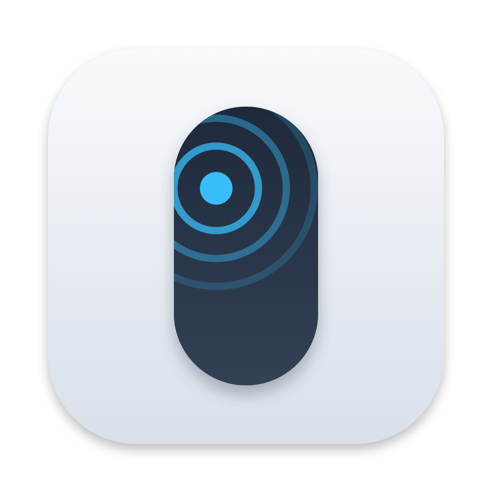

# Quiet Mouse

[](LICENSE)
[](https://github.com/yezicheng2011/QuietMouse/releases)


<p align="center">
  <picture>
    <source media="(prefers-color-scheme: dark)" srcset="Icon/Logo-Dark.png">
    
  </picture>
</p>

**Tap-to-click for the Apple Magic Mouse.** macOS only offers it on trackpads. Quiet Mouse is a small menu-bar app that brings it to the Magic Mouse: a light tap clicks, a light hold drags, and you never have to press the mouse down. Scrolling and gestures stay exactly as they were.

Website: https://quietmouse.org · Personal home: https://danielye2011.uk

## What it does

| You do this | You get |
| --- | --- |
| Tap the **left half** of the surface | Left click |
| Tap the **right half** of the surface | Right click |
| Tap twice quickly | Double click |
| **Hold** a finger still for about 0.4 s, then move the mouse | Press-and-drag (select text, move files, resize windows) |
| Lift the finger | Releases the drag |
| Press the mouse down as usual | Works exactly as before |

- The left/right split follows **System Settings → Mouse → Secondary click**. With a single-button setup, every tap is a left click.
- Quiet Mouse ignores touches that aren't taps: two fingers, a swiping finger, a moving pointer, or a finger left down too long.
- A tap that coincides with a physical press is dropped, so you never get a double click.
- The drag only begins once you move after holding. Resting a finger on the mouse without moving it never clicks anything.

## The menu-bar icon

A mouse glyph in the menu bar means the app is running. Its menu offers:

- **Tap to Click** — switch tapping on or off without quitting.
- **Hold to Drag** — switch press-and-hold on or off.
- **Grant Permissions…** — shown only while a permission is missing; opens the right settings page.
- **Open at Login** — start automatically (put the app in Applications first).

The app icon and the menu-bar glyph both follow light and dark mode.

## Install

Download `QuietMouse-<version>-macos.zip` from [Releases](https://github.com/yezicheng2011/QuietMouse/releases), unzip it, and drag `QuietMouse.app` into Applications.

The app is not notarized by Apple, so the first launch needs a few extra steps:

1. Control-click the app and choose **Open**, or open System Settings → Privacy & Security and click **Open Anyway**.
2. Allow **Accessibility** (to send clicks) and **Input Monitoring** (to tell your taps from physical presses) when prompted.
3. Make sure the Magic Mouse is connected over Bluetooth.

Requires macOS 13 or later and a Magic Mouse with a multi-touch surface. Trackpads are ignored on purpose.

## Troubleshooting

**Taps are detected but nothing clicks.** The permissions are missing or stale. macOS ties them to the app's signature, so a new build or update can leave an old entry that *looks* switched on but no longer applies. In System Settings → Privacy & Security, select Quiet Mouse under both **Accessibility** and **Input Monitoring** and remove it with **−**, add `QuietMouse.app` back with **+**, then quit and reopen the app.

**Left and right feel swapped.** Run the app once with `--flip` to confirm (see below), then open an issue so the default can be fixed for your mouse.

**Taps miss or fire too easily.** The thresholds are constants at the top of [`quietmouse.swift`](quietmouse.swift): `maxTapDuration`, `maxTouchTravel`, `maxCursorTravel` and `holdDelay`. Change them and rebuild.

## Build from source

You need macOS 13 or later and the Xcode command-line tools (`swiftc`).

```bash
./build.sh
```

This produces a universal `QuietMouse.app` in the current directory.

Rebuilding changes the app's signature, so macOS will ask for the permissions again (see Troubleshooting). To avoid that during development, sign with a stable local certificate instead of the default ad-hoc one: edit the `codesign` line in `build.sh` to use your certificate's name.

Debug helpers (run the binary directly):

```bash
QuietMouse.app/Contents/MacOS/QuietMouse --debug   # log every tap, hold and drag decision
QuietMouse.app/Contents/MacOS/QuietMouse --flip    # mirror the left/right zones
QuietMouse.app/Contents/MacOS/QuietMouse --list    # list detected multi-touch devices
```

To regenerate the icons:

```bash
swift Icon/make-icons.swift Icon
iconutil -c icns Icon/AppIcon.iconset -o Icon/AppIcon.icns
```

## How it works

Quiet Mouse reads raw contact points from the Magic Mouse through Apple's private `MultitouchSupport` framework.

- **Tap.** One finger that lands and lifts within about 0.25 s, barely moves, and arrives while the pointer is still becomes a synthetic click at the pointer's position.
- **Hold.** A finger that stays still, with the pointer still, for about 0.4 s arms a drag. On the first pointer movement after that, Quiet Mouse posts a mouse-down at the held spot and turns the following movement events into drag events until the finger lifts.
- **Physical presses** are watched through a CGEvent tap, and take priority over synthetic input.

Because it relies on a private framework, a future macOS update could break it.

## License

Apache License 2.0. Copyright 2026 Ye Zicheng.
